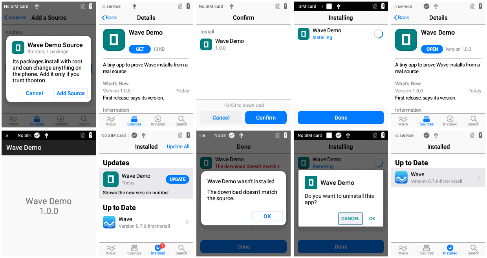

# First install from a real source

On 2026-11-19, Wave installed, updated and removed an app published by
`wavesrc` into a real source. The whole run used the d-pad on the stock,
unrooted XP3800 `8516067e` (firmware `3A.0.1-02-8.1.0-11.20.00`). Before this,
the engine had only installed things in host tests and through a fake `su`.
See [first-phone.md](first-phone.md) for the browse-only stock pass.

From left to right, top row: the new source's preview, Details with GET,
Confirm, the queue, and Details with OPEN. Bottom row: the installed app
running, the UPDATE on Installed, the alert for a download that doesn't match
its hash, Android's uninstall prompt, and Installed after the removal.

## Setup

Nothing on the phone was changed apart from what Wave itself did. No root,
no system CA and no settings were touched. Everything is in the local scratch
folder `.oak/tmp/temp4/fi/`, which isn't committed.

- **The test app.** `com.wave.xp3.demo` ("Wave Demo") is one activity that
  shows its version. It was built with aapt2, javac and d8, then signed with
  the shared key (`signing/debug.keystore`) as 1.0.0 (code 1), 1.1.0 (code 2)
  and 1.2.0 (code 3). Each APK is 12,788 bytes.
- **The source.** A Git repository with its own `wave.json` ("Wave Demo
  Source", one section). Each version was added by `tools/wavesrc/wavesrc
  publish` with a `https://localhost:4483/files/wave-demo-<v>.apk` download
  URL, then committed. `wavesrc lint --download` passed against the server.
- **The server.** A Python HTTPS server on 127.0.0.1:4483. It answers Git
  smart HTTP for `/demo` through `git http-backend`, using
  `app/core/test-tools/git_fixture.py`, and serves the APKs under `/files/`.
  The certificate is a throwaway self-signed one for `localhost`.
  `adb reverse tcp:4483 tcp:4483` made it reachable from the phone.
- **Wave.** A release build of HEAD (0.7.6, `versionName
  0.7.6-first-install`), changed in a scratch copy only by a
  `networkSecurityConfig` that trusts that certificate for `localhost` and
  `127.0.0.1`. That is the method agent 4 used for the first-phone pass. The
  shipping code, engine and installer path are unchanged.

## What happened

| Step | What the phone did |
| :--- | :--- |
| Add the source | Home > Add a Source. The address field was cleared and `https://localhost:4483/demo` typed in; the digits needed long presses, as in first-phone.md. The preview read "Wave Demo Source, thooton, 1 package" with the trust warning. Add Source fetched it: one advertisement and two upload-pack POSTs, all 200. |
| Browse | Sources > Wave Demo Source showed All Packages 1, Applications 1, with Wave Demo as Featured. Details showed GET, 13 KB, and What's New "Version 1.0.0, First release, says its version." |
| GET | OK on GET > Confirm ("Install, Wave Demo 1.0.0, 13 KB to download") > Confirm. The server logged one `GET /files/wave-demo-1.0.0.apk` (200, no Range). The engine checked the size and SHA-256, then the file (package ID and version) with `getPackageArchiveInfo`. |
| Handover | StockApps started (03:08:00.26). It handed `content://com.wave.xp3.apks/engine-….apk` to `com.installer.xp3/.InstallActivity` with the expected package (03:08:00.32). Installer is the phone's device owner, so its session installed straight away. There was **no install prompt**, as designed. dexopt ran at 03:08:01.5, and `PACKAGE_ADDED` arrived at 03:08:02.2. `dumpsys package`: `versionName=1.0.0`, `installerPackageName=com.installer.xp3`. |
| Receipt and OPEN | The queue said Done. Details flipped to OPEN with "Version 1.0.0", and Installed listed "Wave Demo, Version 1.0.0" with OPEN, which comes from Wave's receipt plus the installed package. OPEN launched the app, which showed "Wave Demo 1.0.0". The receipt file itself wasn't read, because a release build can't be `run-as`. |
| Update | 1.1.0 was published and committed, then Sources > Refresh. Installed showed "Updates: Wave Demo, UPDATE, Today, Shows the new version number." UPDATE > Confirm ("1.0.0 → 1.1.0") > Confirm downloaded and installed it silently in the same way (`versionName=1.1.0`). The row moved back to Up to Date. |
| Bad hash | 1.2.0 was published, but the server was given 1.1.0's bytes under 1.2.0's name. The size was the same; the hash was not. UPDATE > Confirm downloaded it, and Wave refused it: "Wave Demo wasn't installed. The download doesn't match the source." The phone stayed on 1.1.0. With the right file back, UPDATE installed 1.2.0. |
| Remove | Installed > Menu on Wave Demo > Remove > Confirm opened **Android's own uninstall prompt** ("Do you want to uninstall this app?"). Without root, Wave uses `ACTION_UNINSTALL_PACKAGE`. The prompt starts on CANCEL, so it takes Right, then OK. Wave saw the package gone, the queue said Done, and Installed listed only Wave. |
| Remove the source | Sources > Menu > Remove Source > Remove: the source left the list. |

## Found and fixed

- **A stale failure alert.** After the bad-hash run, the retry installed 1.2.0
  correctly, but the new queue screen first showed the previous run's alert
  ("wasn't installed, doesn't match the source"). Fixed in `f886fda`: the
  queue screen waits for its own run. A matching change in the data layer,
  which clears a finished queue when a new plan starts, is still to be
  committed. A re-run on a build of `f886fda` (bad hash,
  then GET again with the right file) went straight to Done with no alert.
- **The trust warning** says "Its packages install with root and can change
  anything on the phone" even for a source of plain apps, which install
  without root on stock. It was handed to the UI owner and is still open.

## Cleanup

Wave Demo was removed through Wave, the source was removed, and Wave was
uninstalled. The reverse on tcp:4483 was removed. The phone has the same 21
`xp3` packages as before.

## Still open

- Downloads that need a sign-in (private sources; decisions open item 4).
- The same cycle against the hosted default source, once it is published.
- Everything that needs root: mods, the watchdog and self-update through root
  ([ROOT-TESTING.md](../app/ROOT-TESTING.md)).
